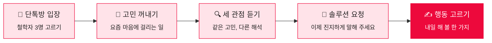
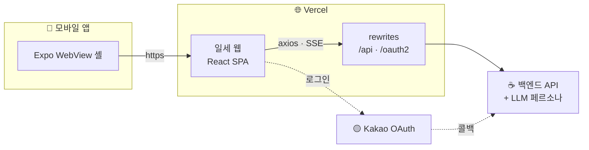
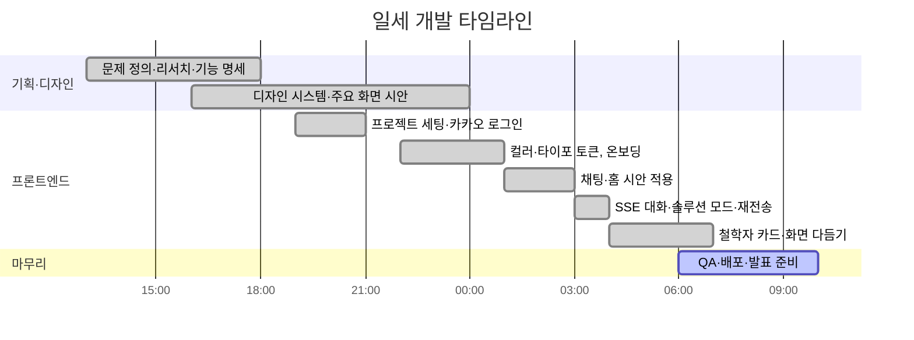

<div align="center">


</div>


## 📌 목차

1. [왜 만들었나](#-왜-만들었나)
2. [일세라는 이름](#-일세라는-이름)
3. [이렇게 써요](#-이렇게-써요)
4. [단톡방의 철학자들](#-단톡방의-철학자들)
5. [핵심 기능](#-핵심-기능)
6. [기술 스택과 구조](#-기술-스택과-구조)
7. [개발 타임라인](#-개발-타임라인)
8. [시작하기](#-시작하기)
9. [시연 영상](#-시연-영상)


## 💭 왜 만들었나

> 같은 보고서, 같은 회의, 같은 하루. 지루하다고 말하기엔 사소하고, 그냥 넘기기엔 자꾸 걸리는 마음.

- **반복이 쌓이면 일이 의미를 잃는다.** 직장인 상당수가 "반복되고 의미 없는 업무"를 권태의 이유로 꼽는다 _(엠브레인 트렌드모니터, 2024)_
- **그런데 말할 곳이 없다.** 상사에게는 조심스럽고, 동료에게는 부담스럽다.
- **이미 AI에게는 털어놓고 있다.** 직장인 절반 가까이가 AI에게 고민을 상담해 본 적이 있다 _(나우앤서베이, 2026)_

그래서 **"정답을 주는 상담사"** 대신 **"시대가 다른 세 사람의 수다"** 를 택했습니다.
익숙한 고민을 낯선 관점으로 보면, 내일 해 볼 수 있는 작은 행동이 보이니까요.

```
   일 (Work)    ×    낯설게 (Defamiliarize)    =    일세
 꺼내기 어려운        다른 시대를 산              세 철학자와 나누는
  직장 고민           철학자의 시선               직장 고민 상담
```


## 🏷️ 일세라는 이름

| 읽는 법 | 뜻 | 담은 의도 |
| :---: | :--- | :--- |
| **일 + 세** | 일고민 하나, 철학자는 셋 | 고민 하나를 세 사람이 각자 다르게 본다 |
| **~일세** | "자네에게 필요한 건 산책일세." | 철학자 캐릭터들의 예스러운 말투 |
| **一世** | 한평생 | 일은 인생의 큰 부분. 오늘의 지루함을 삶 전체에서 다시 본다 |


## 🧭 이렇게 써요



<details>
<summary><b>💡 예시 대화 펼쳐 보기</b></summary>


> 🙋 **나** — 회의에서 바로 대답을 못 하면, 제가 일을 못하는 사람 같아요.

> 🏛️ **에픽테토스** — 동료의 평가는 자네 뜻대로 되지 않네. 다음 회의 전에 무엇을 준비할지는 자네 뜻대로 되지.

> ⚡ **니체** — 빨리 답해야 유능하다는 기준, 누가 정했나? 그 기준부터 의심해 보게!

> 🦋 **장자** — 옆자리 동료도 같은 대목에서 머뭇거렸을지 모르지. 한 걸음 물러서서 보게나.

</details>


## ✨ 핵심 기능

| | 기능 | 설명 |
| :---: | :--- | :--- |
| 👥 | **철학자 단톡방** | 9명 중 3명을 골라 방을 만들고, 한 고민에 세 사람이 차례로 답해요 |
| ⌨️ | **한 명씩 "입력 중…"** | 서버는 한 턴의 답을 한꺼번에 보내지만, 화면에서는 철학자가 한 명씩 타이핑하듯 등장해요 |
| 🎯 | **솔루션 모드** | 수다가 충분히 쌓이면 "이제 진지하게" 버튼으로 실천할 수 있는 조언을 받아요 |
| 🔁 | **끊겨도 이어지는 대화** | 스트림이 끊기면 대화 이력으로 결과를 다시 확인하고, 실패한 메시지는 다시 보낼 수 있어요 |
| 📚 | **철학자 둘러보기** | 시대·말투·대화 방식까지, 단톡방에 부르기 전에 미리 알아봐요 |
| 🟡 | **카카오 로그인** | 앱(WebView) 안에서 끊김 없이 이어지는 카카오 OAuth |


## 🛠️ 기술 스택과 구조

<div align="center">

| 분류 | 사용 |
| :---: | :--- |
| **Core** | React 19 · TypeScript · Vite |
| **Routing** | react-router (`createBrowserRouter`) |
| **Style** | Tailwind CSS v4 · `@theme` 디자인 토큰 (Main Red `#ED093C` + 철학자 9색) · Pretendard |
| **State** | Zustand (도메인별 스토어) |
| **Network** | axios · fetch 기반 SSE · JWT 자동 갱신 |
| **Lint** | oxlint |
| **Deploy** | Vercel (`main`만 프로덕션 배포) |
| **Shell** | Expo + react-native-webview |

</div>



> 백엔드는 웹과 **같은 주소 아래로 프록시**합니다. 다른 도메인을 직접 부르면 iOS·Safari에서 로그인 쿠키가 막히기 때문이에요.

<details>
<summary><b>📂 폴더 구조</b></summary>

```
src/
├─ main.tsx              # 라우터
├─ index.css             # Tailwind + 디자인 토큰
├─ pages/                # Splash · Login · Onboarding · Home · Chat · Explore · MyPage …
├─ components/
│  ├─ common/            # Layout · Header · BottomNavigation 등 공통 부품
│  └─ widgets/           # auth · chat · home · onboarding · philosopher
├─ stores/               # useAuthStore · useChatStore · usePhilosopherStore
├─ lib/                  # api · sse · philosophers · utils
└─ types/
```

</details>


## ⏱️ 개발 타임라인

**2026.11.21 (토) ~ 11.22 (일)**, 무박으로 달린 기록입니다.



| 시간 | 한 일 |
| :---: | :--- |
| 🕐 **11/21 오후** | 주제 확정, 리서치, 핵심 문제·기능 정의 |
| 🕖 **19:00** | 프로젝트 초기 설정, 카카오 로그인 |
| 🕙 **22:00** | 컬러 팔레트·타이포그래피 토큰, 온보딩 |
| 🕐 **01:00** | 채팅·홈 시안 적용 (말풍선, 입력 중 표시, 하단 탭) |
| 🕒 **03:00** | 조언 모드·전송 실패 재시도 — 커밋이 가장 몰린 시간 🔥 |
| 🕔 **05:00** | 철학자별 컬러 아바타, 디테일 폴리싱 |
| 🕕 **06:00** | 최종 QA, 배포, 발표 🎤 |


## 🚀 시작하기

> Node **24**, yarn **1** 이 필요합니다.

```bash
yarn install
echo "API_PROXY_TARGET=<백엔드 주소>" > .env   # 주소는 팀에 문의
yarn dev               # 같은 와이파이의 휴대폰에서도 접속 가능
```

| 명령 | 설명 |
| :--- | :--- |
| `yarn dev` | 개발 서버 |
| `yarn build` | 타입 검사 + 프로덕션 빌드 → `dist/` |
| `yarn lint` | oxlint |


## 🎬 시연 영상

<div align="center">

<a href="https://youtube.com/shorts/T2YYZN0j3wo?feature=share">
  
</a>


[](https://youtube.com/shorts/T2YYZN0j3wo?feature=share)


</div>
