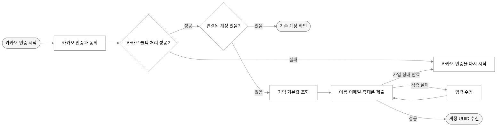

# 카카오 로그인·회원가입 기능 명세

| 항목 | 내용 |
| --- | --- |
| 기능 | 카카오 인증, 기존 계정 확인, 신규 계정 생성 |
| 문서 상태 | 서버 구현 기준 |
| 적용 버전 | 2026-11-21 로컬 백엔드 코드 |
| 관리 담당 | 미지정 |
| 최종 수정일 | 2026-11-21 |

## 1. 목적과 사용자

- 사용자는 카카오 계정으로 본인을 인증하고, 연결된 서비스 계정이 없으면 회원가입을 완료한다.
- 기존 사용자는 연결된 계정의 존재 여부를 확인할 수 있다.

## 2. 제공 범위와 관련 기능

### 현재 제공 범위

- 카카오 인증 화면으로 이동하고 인증 결과를 받아 기존 계정과 신규 가입을 구분한다.
- 신규 사용자는 카카오에서 제공한 닉네임·이메일을 가입 입력의 기본값으로 사용할 수 있다.
- 가입이 완료되면 계정 UUID를 반환한다.

### 관련 기능과 책임 경계

| 관련 기능 | 연결·책임 |
| --- | --- |
| 카카오 인증·동의 | 카카오가 사용자 인증과 정보 제공 동의를 처리한다. Spring은 콜백의 `state`를 확인하고 인가 코드 교환과 사용자 정보 조회를 수행한다. |
| 서비스 계정 생성 | Spring이 입력값을 검증하고 PostgreSQL의 `users.account`와 `auth.oauth_identity`를 한 트랜잭션에서 저장한다. |

### 추후 제공·범위 제외

| 구분 | 항목 |
| --- | --- |
| 로그인 유지 | 서비스 인증 토큰 발급·갱신, 로그아웃, 인증이 필요한 서비스 API 접근 |
| 외부 계정 | 카카오 외 소셜 제공자, 기존 계정에 소셜 계정 추가 연결·연결 해제 |
| 사용자 화면 | 로그인·가입 페이지와 인증 완료 후 화면 이동 |

## 3. 도메인 정책

### 입력 정보

| 항목 | 필수 여부 | 입력·검증 기준 |
| --- | --- | --- |
| 이름 | 필수 | 앞뒤 공백 제거 후 1~100자. 카카오 닉네임을 기본값으로 사용할 수 있다. |
| 이메일 | 필수 | 앞뒤 공백 제거 후 이메일 형식, 최대 254자. 카카오 이메일과 다른 주소도 제출할 수 있다. |
| 휴대폰 번호 | 필수 | `010`으로 시작하는 숫자 11자리. 공백·하이픈 없이 입력한다. |

### 이용 정책

| 정책 | 내용 |
| --- | --- |
| 계정 식별 | 카카오 회원번호를 문자열로 저장하고 `(provider, subject)`로 조회한다. 이메일과 휴대폰 번호는 가입 정보로 저장하며 계정 자동 병합에 쓰지 않는다. 입력 연락처에 대한 소유 확인은 제공 범위 밖이다. |
| 기존 회원 | 카카오 식별자에 계정이 연결되어 있으면 `signupRequired: false`를 반환한다. |
| 신규 사용자 | 카카오 인증 성공 후 서버에 가입 대기 상태를 만든다. 계정 생성은 가입 제출 시 수행한다. 닉네임이나 이메일이 없어도 유효한 카카오 회원번호가 있으면 가입할 수 있다. |
| 가입 유효기간 | 카카오 인증 완료 후 30분 동안 유효하다. 가입 정보 조회나 재제출로 기한이 연장되지 않는다. |
| 중복 가입 | 같은 카카오 식별자로 동시에 제출하면 먼저 처리된 요청이 계정을 생성한다. 가입 대기 상태가 유효한 후속 요청은 기존 계정 UUID를 받고 기존 프로필은 보존된다. |
| 완료와 실패 | 계정과 소셜 식별자 저장이 커밋되면 가입 대기 상태를 소비한다. 저장이 롤백되면 유효기간 내에 같은 상태로 다시 제출할 수 있다. |

## 4. API

카카오 기능을 활성화한 서버 기준이다. JSON 응답은 공통 `code`, `message`, `data` 형식을 사용한다. OAuth 시작과 콜백에는 Spring Security의 프로토콜 경로를 사용한다. 가입 정보 조회와 제출에는 콜백에서 발급된 세션 쿠키를 사용한다. [API 컨벤션](../../API_CONVENTION.md)

서버에서는 `KAKAO_LOGIN_ENABLED=true`, `KAKAO_CLIENT_ID`, `KAKAO_CLIENT_SECRET`, `KAKAO_REDIRECT_URI`를 설정한다. 콜백 URL은 카카오에 등록한 값과 일치해야 하며, 브라우저는 세션 쿠키를 보낼 수 있도록 인증 시작과 콜백에 같은 호스트를 사용한다. [서버 설정](../../backend/src/main/resources/application.properties)

| 호출 방향 | 요청 | 반환 결과 |
| --- | --- | --- |
| 사용자 브라우저 → Spring | `GET /oauth2/authorization/kakao` | `302`와 카카오 인증 URL |
| 카카오 → 사용자 브라우저 → Spring | `GET /login/oauth2/code/kakao` | `200`과 가입 필요 여부 |
| 사용자 → Spring | `GET /api/v1/auth/signup` | `200`과 가입 기본값·CSRF 토큰 |
| 사용자 → Spring | `POST /api/v1/auth/signup` | `201`과 생성된 계정 UUID. 유효한 가입 요청 처리 중 이미 연결된 계정이 확인되면 `200`과 해당 UUID |

### 카카오 인증 시작 `GET /oauth2/authorization/kakao`

- 요청에 필요한 쿼리 파라미터와 본문은 없다. 브라우저가 인증 시작 URL로 이동한다.
- `302 Found`의 `Location`은 `https://kauth.kakao.com/oauth/authorize`다. 서버가 `response_type=code`, `client_id`, `redirect_uri`, `state`를 인증 URL에 넣는다. 응답에 JSON 본문은 없다.
- Spring이 세션에 인증 요청을 저장한다. 브라우저는 콜백에서 같은 세션 쿠키를 보내야 한다.

### 카카오 콜백 `GET /login/oauth2/code/kakao`

| 입력 위치 | 필드 | 형식과 의미 |
| --- | --- | --- |
| 쿼리 | `code` | 카카오가 성공 시 전달하는 인가 코드 문자열 |
| 쿼리 | `state` | 인증 시작 시 발급한 값. 시작 세션에 저장된 값과 일치해야 한다. |
| 쿼리 | `error`, `error_description` | 사용자가 인증을 취소했거나 카카오가 오류를 반환할 때 전달할 수 있는 값 |
| 쿠키 | `JSESSIONID` | 인증 시작에 사용한 서버 세션 |

`200 OK` 응답의 `data.signupRequired`는 불리언이다. 값이 `true`이면 서버가 새 가입 세션 쿠키를 발급한다. 값이 `false`이면 기존 계정 확인으로 흐름이 끝난다.

```json
{
  "code": "SUCCESS",
  "message": "카카오 인증을 완료했습니다.",
  "data": { "signupRequired": true }
}
```

### 가입 기본값 조회 `GET /api/v1/auth/signup`

- 콜백에서 발급된 `JSESSIONID`를 보낸다. 쿼리 파라미터와 본문은 없다.
- `200 OK`에서 `name`은 카카오 닉네임, `email`은 카카오 이메일이다. 각각 제공되지 않으면 `null`이다. `csrfToken`은 가입 제출 헤더에 넣을 문자열이다.

```json
{
  "code": "SUCCESS",
  "message": "가입 정보를 조회했습니다.",
  "data": { "name": "철학친구", "email": "user@example.com", "csrfToken": "example-token" }
}
```

### 계정 생성 `POST /api/v1/auth/signup`

| 입력 위치 | 필드 | 필수 | 값 |
| --- | --- | --- | --- |
| 헤더 | `Content-Type` | 예 | `application/json` |
| 헤더 | `X-CSRF-TOKEN` | 예 | 가입 기본값 조회의 `data.csrfToken` |
| 쿠키 | `JSESSIONID` | 예 | 가입 기본값 조회와 같은 세션 쿠키 |
| 본문 | `name` | 예 | 문자열. 앞뒤 공백 제거 후 1~100자 |
| 본문 | `email` | 예 | 문자열. 앞뒤 공백 제거 후 이메일 형식, 최대 254자 |
| 본문 | `phone` | 예 | 문자열. `010`으로 시작하는 숫자 11자리 |

```json
{
  "name": "홍길동",
  "email": "user@example.com",
  "phone": "01012345678"
}
```

최초 생성은 `201 Created`를 반환한다. 유효한 가입 요청이 처리될 때 동일한 카카오 식별자가 이미 연결돼 있으면 `200 OK`와 같은 응답 형식으로 기존 `accountId`를 반환한다. `accountId`는 UUID 문자열이다.

```json
{
  "code": "SUCCESS",
  "message": "가입을 완료했습니다.",
  "data": { "accountId": "f993b52a-33d8-4edd-9ab9-bd74bc674ac1" }
}
```

### 오류 응답

| API | 상황 | HTTP | `code` | 처리 |
| --- | --- | --- | --- | --- |
| 콜백 | 카카오 인증 취소·실패, 인가 코드 또는 `state` 누락, `state` 불일치, 인증 시작 세션 유실, 코드 교환 또는 사용자 정보 조회 실패 | `400` | `AUTH_OAUTH_FAILED` | 카카오 인증을 다시 시작한다. |
| 콜백 | 사용자 정보가 매퍼까지 전달됐지만 회원번호 값이나 프로필 필드 형식이 올바르지 않음 | `400` | `AUTH_OAUTH_RESPONSE_INVALID` | 가입을 중단하고 인증을 다시 시작한다. |
| 가입 제출 | JSON 파싱 실패 또는 요청 본문을 읽을 수 없음 | `400` | `COMMON_MALFORMED_REQUEST` | JSON 형식을 수정한다. |
| 가입 조회·제출 | 가입 대기 상태 없음, 만료 또는 이미 소비됨 | `401` | `AUTH_SIGNUP_EXPIRED` | 카카오 인증을 다시 시작한다. |
| 가입 제출 | CSRF 토큰 누락·불일치. 세션 쿠키가 없어서 토큰을 검증할 수 없는 경우 포함 | `403` | `AUTH_FORBIDDEN` | 세션을 유지한 채 가입 기본값을 다시 조회한다. 가입 대기 상태가 없으면 인증을 다시 시작한다. |
| 가입 경로 | `GET`·`POST` 이외의 메서드 사용 | `403` | `AUTH_FORBIDDEN` | 명세에 있는 메서드를 사용한다. |
| 가입 제출 | JSON으로 처리할 수 없는 `Content-Type` | `415` | Spring 기본 오류 응답 | `Content-Type: application/json`으로 보낸다. |
| 가입 제출 | 필수값 누락·공백, 이메일 형식·길이 제한 위반, 휴대폰 번호 형식 위반 | `422` | `COMMON_VALIDATION_FAILED` | `data` 배열의 `pointer`로 수정할 필드를 찾는다. |
| 콜백·가입 | DB 조회·저장 실패 또는 예상하지 못한 서버 오류 | `500` | Spring 기본 오류 응답 | 콜백 실패는 인증을 다시 시작한다. 가입 저장이 롤백된 경우에는 유효기간 내 다시 제출할 수 있다. |

가입 제출은 CSRF 검사, 요청 본문 처리, 가입 대기 상태 확인 순으로 진행된다. 세션과 CSRF 토큰이 둘 다 없으면 `401`에 앞서 `403`이 반환된다. 기능 오류 응답의 `data`는 `null`이며, 필드 검증 오류에서만 배열을 사용한다. `415`와 `500`의 Spring 기본 오류에는 이 기능이 정의한 `code`가 없다.

```json
{
  "code": "AUTH_SIGNUP_EXPIRED",
  "message": "카카오 인증부터 다시 진행해 주세요.",
  "data": null
}
```

```json
{
  "code": "COMMON_VALIDATION_FAILED",
  "message": "입력값이 올바르지 않습니다.",
  "data": [
    { "pointer": "/name", "code": "NotBlank", "detail": "must not be blank" }
  ]
}
```

필드 오류의 `code`는 적용된 검증 어노테이션에 따른다. `detail`은 요청 언어에 따라 달라질 수 있다.

## 5. 사용자 흐름



## 6. 변경 이력

| 변경일 | 변경 내용·이유 | 적용 버전 |
| --- | --- | --- |
| 2026-11-21 | 카카오 인증부터 계정 저장까지의 정책, API 계약과 오류 응답을 현재 서버 구현 기준으로 기록했다. | 로컬 백엔드 코드 |


## 7. 미결정 사항

서비스 로그인 유지 방식과 카카오 인증 후 이동할 화면은 현재 구현 범위 밖이다. 실제 카카오 앱 연동은 새 Credential과 콜백 URI 등록 후 확인한다.